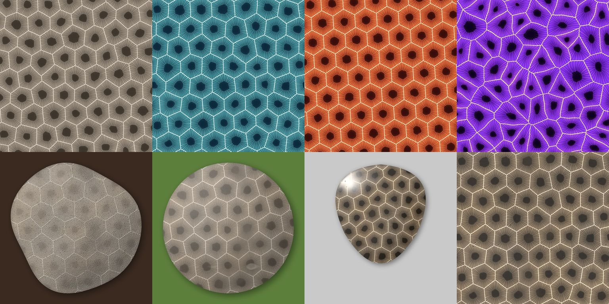

# petoskeystone

A Node.js command-line tool that procedurally generates images of **Petoskey stones**, the fossil colonial coral *Hexagonaria percarinata*. It can render them stylized or photo-real (raw, tumbled or polished), as seamless tiles or stone silhouettes, and output PNG, JPEG, JPEG XL or AVIF.



Run `npm run examples` to render a gallery of sample looks into `examples/` (it also refreshes `README.jpg`).

## Requirements

Node.js ≥ 23.6. The source is TypeScript (`.mts`) and Node runs it directly with built-in type stripping, so there is no build step.

```sh
npm install
node src/cli.mts --help        # or: npm start -- --help, or `npm link` then `petoskeystone`
```

## Examples

```sh
# Photo-real polished stone, guitar-pick shape, transparent background, AVIF
petoskeystone --finish polished --shape triangle -o pick.avif

# Raw beach find on dark sand
petoskeystone --finish raw --shape pebble --size 1600x1200 --background '#3a2a20' -o raw.jpg

# Seamless 1024² tile in a substitute palette
petoskeystone --style stylized --palette ocean --repeat --size 1024x1024 -o tile.png

# Your own colors (wall,body,eye[,septa,matrix]) with perfect hexagons
petoskeystone --style stylized --palette custom --colors '#fff8e7,#4a6fa5,#0b1d3a' \
  --regularity 1 --wobble 0 -o hex.jxl

# Reproduce an image exactly (the seed is printed after every run)
petoskeystone --seed 12345 -o same.png
```

Options can also come from a JSON file that uses the same names as the flags, for example `{"style": "stylized", "cell-size": 90}`. Load it with `--config file.json`; any flags on the command line override the file.

## Options

| Option | Meaning | Default |
|---|---|---|
| `--style` | `stylized` (flat, graphic) or `realistic` (shaded, textured) | `realistic` |
| `--finish` | `raw`, `tumbled` or `polished` (realistic only) | `polished` |
| `--palette` | `natural`, `ocean`, `ember`, `moss`, `mono`, `neon`, `sandstone`, `custom` | `natural` |
| `--colors` | with `custom`: `wall,body,eye[,septa,matrix]` hex colors | — |
| `--cell-size` | mean corallite diameter in output pixels: the pattern's **scale** | 160 |
| `--regularity` | 0 = chaotic polygons … 1 = perfect hexagons | 0.6 |
| `--wobble` | waviness of corallite walls | 0.3 |
| `--repeat` | seamless repeating tile (rect only) | off |
| `--size WxH` / `--width` / `--height` | output pixel size | 2048×2048 |
| `--shape` | `rect`, `ellipse`, `cabochon`, `triangle`, `pebble` | `rect` |
| `--background` | `transparent` or `#rrggbb` (silhouettes) | `transparent` |
| `--no-shadow` | no drop shadow under silhouettes | — |
| `--light az,el` | light direction in degrees (0 = from the right, 90 = from the top) | `135,45` |
| `--quality`, `--effort`, `--lossless` | encoder settings (quality defaults: jpeg 90, avif 60, jxl 85) | — |
| `--supersample` | anti-aliasing factor, 1–4 | 2 |
| `--threads` | worker threads (1 = none) | CPU count |
| `--seed` | reproducible randomness | random |
| `-o`, `--output` / `--format` | output file; format comes from the extension unless `--format` is given | — |

## How it works

1. **Layout** (`src/layout.mts`). The corallite centers start as a hex lattice. That lattice is randomly rotated, or fitted exactly to the tile when repeating. The centers are then jittered according to `--regularity` and relaxed with Lloyd iterations. Each corallite gets a small weight, which turns the cells into a *power diagram*: the walls stay straight while the cell sizes vary.
2. **Fields** (`src/fields.mts`). For every pixel, the tool computes its corallite, the exact distance to the nearest wall, and polar coordinates around the corallite's center. Domain warping (`--wobble`) bends the walls. A precomputed candidate list per bucket keeps each pixel's lookup to about a dozen points.
3. **Anatomy** (`src/corallite.mts`). Each corallite is built from:
   - a dark **eye** (calyx) with a noisy, star-shaped edge;
   - major and minor **septa** that thicken toward the wall and meet it in a zigzag;
   - a net of concentric **dissepiments**;
   - pale **walls**.
4. **Rendering** (`src/render/`). *Stylized* mixes palette colors from those masks in linear light. *Realistic* runs two passes:
   - **Albedo and height.** This covers mottling, contrast and the "wet look", matrix patches, stains, pits, chips and voids, plus fossil relief, roughness and a dome for silhouettes.
   - **Lighting.** This uses Lambert diffuse, Blinn-Phong specular, a soft sheen and a Fresnel-like rim.

   Each finish is a set of parameters in `FINISH_PARAMS`. Rows are split across `worker_threads`, and the output is byte-identical for any thread count.
5. **Shapes** (`src/shape.mts`). Silhouettes are drawn anti-aliased with `@napi-rs/canvas`. A distance transform, computed at low resolution and smoothed, gives the dome profile and the drop shadow.
6. **Encoding** (`src/encode.mts`). `sharp` downsamples the supersampled image (tiles are wrap-padded first, so no seam appears) and encodes PNG, JPEG (mozjpeg), AVIF and JPEG XL.

   The prebuilt `sharp` binaries lack libjxl, so JPEG XL falls back to the [`@jsquash/jxl`](https://github.com/jamsinclair/jSquash) WebAssembly encoder. If your `sharp` is built against a libvips with JPEG XL support, the tool uses `sharp` instead.

## Development

```sh
npm run typecheck   # tsc --noEmit
npm test            # node:test, covering determinism, thread-independence,
                    # seamless tiling, hexagon regularity, all formats, CLI errors
npm run examples    # regenerate examples/
```
